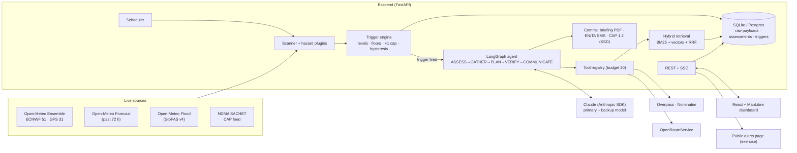

# T-Minus

**The anticipatory-action agent for district disaster management.**

> India forecasts well. T-Minus turns forecasts into action — before the disaster, not after.

51 parallel forecasts → a real probability → a pre-agreed trigger → an agent that reads the district's own disaster plan → cited actions on a countdown → human approval.

Built for the **Forge Gen AI Buildathon · Theme 2: Climate, Resource Infrastructure & Global Supply Resilience**. Primary hazard: extreme rainfall and flooding in Tamil Nadu (all 38 districts) plus a watch-list of high-risk districts elsewhere. Full specification: [`SPEC.md`](SPEC.md).

---

## What it does

| | |
|---|---|
| **Live risk scanner** | Every hour (cached per model run) it fetches the ECMWF 51-member ensemble for every monitored district, the GloFAS river forecast, rainfall of the past 72 h, and NDMA SACHET official alerts. |
| **Probabilistic triggers** | Code computes, for each district, *P(24-h rain ≥ IMD threshold within W hours)* = members that exceed ÷ valid members — e.g. **74.5% (38 of 51 forecasts)** — then maps it to WATCH / PREPARE / ACT with official-alert floors, a +1 escalation cap (saturated ground, compound river hazard), disagreement flags, and hysteresis counted in **new model runs**. |
| **Agent planner** | A LangGraph state graph (ASSESS → GATHER → PLAN → VERIFY → COMMUNICATE) reads the district's own Disaster Management Plan with hybrid retrieval and drafts actions phased against the countdown (Do now · T-48h · T-24h · T-6h). |
| **Self-verification** | Deterministic code rejects any draft whose quote is not an **exact substring** of the cited page, whose numbers were not produced by code or the documents, whose facilities do not exist in the plan or OpenStreetMap, or whose phase has already passed — and sends specific feedback back (“A4: quote not found on p. 117”). |
| **Live trace** | Every step, tool call, retry and verification result streams to the UI over SSE. |
| **Human approval** | Officers approve / edit / reject every action and message. Publishing needs a two-step confirmation token. Append-only audit log. Nothing is ever sent to SMS, SACHET or government systems. |
| **Communications** | One-page PDF briefing; English (≤ 160 GSM-7) and Tamil (≤ 134 UCS-2) public messages with live counters; CAP 1.2 XML validated against the official OASIS XSD with `status = Exercise`. |
| **Sources panel + chaos switch** | Status, last fetch, latency and model run of every source; admins can force a source to fail (labelled *simulated outage*) to show the ECMWF → GFS fallback live. |
| **Replay** | Backtests real past events (Cyclone Fengal 2024) using **forecasts as issued at the time** (Open-Meteo Previous Runs API — never the Historical Forecast API), reporting when each level would have fired relative to the observed rainfall peak, plus a quiet-period false-alarm check. |

## Live verification (31 Oct 2026)

Run against the real public APIs — screenshots in [`docs/evidence/`](docs/evidence/):

* **Scan:** all 44 districts in **6.1 s** from the live ECMWF 51-member ensemble (model run 2026-10-30 18:00 UTC read from Open-Meteo `meta.json`); member naming, member counts (51 ECMWF / 31 GFS) and hourly coverage confirmed.
* **Triggers:** no district near the very-heavy-rain threshold that day (highest: SPSR Nellore 13.7%, 7 of 51); 7 districts at **WATCH from the GloFAS river rule** (ensemble maximum above each cell's own 1984–2022 P95), opened once and not duplicated by later scans.
* **Replay, Cyclone Fengal (Viluppuram), forecasts as issued by 8 global models:** WATCH 48 h, **PREPARE 30 h**, ACT 24 h before the observed 394.7 mm/24 h peak — target (PREPARE ≥ 24 h) met; no false alarm in the quiet period.
* **SACHET:** per-state CAP feeds (`rss_tamil`, `rss_puducherry`, …) parsed; real IMD Chennai nowcasts matched to districts by name.
* **Knowledge base:** GCC City Disaster Management Perspective Plan 2025 (805 pages → 4,601 chunks) and Puducherry DM Action Plan 2023 (396 pages → 1,726 chunks) ingested from their official URLs; hybrid retrieval returns the right pages and answers "not found" for off-topic queries.
* **Boundaries:** 44/44 districts from OpenStreetMap (via Nominatim). **CAP XSD:** byte-identical to the OASIS original.
* Bugs found only by live data and fixed: river points snapped to the real GloFAS channel, lightning nowcasts no longer act as orange floors, rate-limit (429) handling, table-of-contents pages excluded from retrieval, a replay-endpoint event-loop crash, per-tool timeouts.

> **Open-Meteo quotas:** the free tier is limited per IP per minute and per day, and multi-decade requests (river baselines, replay) count as many calls. Run `compute_river_baselines` once (it waits out per-minute limits) and keep the database between deploys.

## The five golden rules — and where the code enforces them

1. **No mock data. Ever.** Every number on screen comes from an `assessments` row whose `fetch_ids` point at `source_fetches.raw_payload` — the exact API response. *Recompute from raw* (district page, AC-02) re-derives each probability from that payload in front of you. When a source fails the UI shows the failure and the last real value as **STALE** with its timestamp; nothing is interpolated. Test fixtures exist only in `backend/tests/` and never ship.
2. **Code computes, the LLM reasons.** `app/hazards/ensemble_math.py` (probabilities, t\*, onset), `app/triggers/*` (levels, floors, escalation, hysteresis) are pure, unit-tested functions. The agent receives computed summaries, never raw member arrays. `key_numbers` in every plan are copied by code; VERIFY rejects any number in the plan text that does not appear in the evidence.
3. **Every recommendation is grounded.** The LLM may only output `chunk_id + verbatim quote`; document titles and page numbers are filled in by code from the chunk store (`app/agent/runner.py::_enrich_citations`). Ungrounded actions must be labelled *Suggested — not in district plan*.
4. **Humans approve; the system never sends.** `POST /api/communications/{id}/approve` requires an officer session **and** a confirmation token bound to the exact message text (`/confirmation`). “Publish” posts only to the app's own public page; CAP status is always `Exercise` (the validator rejects anything else).
5. **Everyone can explain everything.** Each module opens with a docstring explaining what it does and why; `docs/architecture.md` walks the data flow.

## Architecture



More diagrams (agent graph, trigger lifecycle, ingestion) in [`docs/architecture.md`](docs/architecture.md).

## Quick start (local, < 10 minutes)

Prerequisites: Python 3.11+, Node 20+.

```bash
git clone https://github.com/stgamingff2021-web/T-Minus.git
```

```bash
cd T-Minus && cp .env.example .env
```

Edit `.env`: set `SECRET_KEY` (32+ random characters), `OFFICER_PASSCODE`, `ADMIN_PASSCODE`, and `ANTHROPIC_API_KEY` for the agent (optional — without it the planner runs in retrieval-only mode). Then:

```bash
cd backend && python -m venv .venv && . .venv/bin/activate && pip install -r requirements-dev.txt
```

```bash
cd ../frontend && npm ci && npm run build
```

```bash
cd ../backend && uvicorn app.main:app --port 8000
```

Open <http://localhost:8000>. The first scan starts immediately; the command map fills in as live data arrives (≈ 10–30 s).

**One-time setup of real geography and plans** (from `backend/`, with the venv active):

```bash
python -m scripts.fetch_boundaries
```

```bash
python -m scripts.compute_river_baselines
```

```bash
python -m scripts.ingest_plans --url "<official DDMP PDF URL>" --district chennai --title "Chennai District Disaster Management Plan" --year 2024
```

Or upload official PDFs from the **Plans** page. Plan PDFs and boundaries are downloaded from their official/published sources — they are never committed.

Frontend development with hot reload: `cd frontend && npm run dev` (proxies `/api` to `:8000`) and open <http://localhost:5173>.

### Docker

```bash
docker compose up --build
```

The image builds the dashboard, installs PDF fonts (incl. Noto Sans Tamil) and Tesseract, pre-fetches the local embedding model, and serves everything on port 8000 (`$PORT` honoured). Data lives in the `/data` volume.

### Deploy (free tiers)

* **Render / Railway / Fly / Hugging Face Spaces (Docker):** point the service at this repo's `Dockerfile`, add the environment variables from `.env.example`, attach a persistent volume at `/data` (or set `DATABASE_URL` to a Supabase Postgres). One URL serves both API and dashboard.
* **Split hosting (optional):** dashboard on Vercel with `VITE_API_BASE=https://<backend>`; set `CORS_ORIGINS` on the backend to the Vercel origin.

## Tests

```bash
cd backend && python -m pytest -q -m "not live"
```

76 tests: unit tests for every pure function (rolling accumulation, probability incl. the spec's 38/51 worked example, t\*, onset, level rules, +1 escalation cap, disagreement, hysteresis by model run, SMS segment counting, probability wording, CAP builder + XSD, verbatim-citation checker, number/facility/phase checks, chunker, SACHET parsing, replay no-look-ahead) and integration tests that drive a **full scan** and a **full agent run** (with a scripted LLM double) through mocked HTTP — covering trigger dedupe, stand-down, ECMWF→GFS fallback, all-sources-down, official floors, VERIFY rejection and retry, the approval gate, CAP validity, the audit log, replay without look-ahead, officer stand-down → CAP Cancel, and garbage input (AC-14).

```bash
python -m pytest -q -m live tests/integration/test_live_sources.py
```

Live checks against the real Open-Meteo and SACHET endpoints (skip automatically when unreachable). CI runs both (`.github/workflows/ci.yml`). Acceptance-criteria evidence: [`docs/acceptance.md`](docs/acceptance.md).

## API

| Method | Path | Purpose |
|---|---|---|
| GET | `/api/health` | Liveness, scheduler, last scan, LLM/embedding status |
| GET | `/api/sources` | Per-source status, last fetch, latency, model run |
| POST | `/api/admin/chaos` | Toggle a simulated outage (admin) |
| GET | `/api/districts` · `/api/districts/{id}` | Levels, T-minus, assessment, futures series, triggers |
| GET | `/api/districts/resolve?q=` | Fuzzy district/alias matching |
| GET | `/api/assessments/{id}/recompute` | Recompute probabilities from the stored raw response (AC-02) |
| GET | `/api/fetches/{id}` | Raw fetch record (+ payload) |
| POST | `/api/scan` | Run a scan now |
| GET | `/api/triggers?status=active` · POST `/api/triggers/{id}/close` | Triggers; officer-confirmed stand-down (CAP Cancel) |
| POST | `/api/districts/{id}/plan` | Start an agent run → `run_id` |
| GET | `/api/runs/{id}/events` | SSE agent trace (resumes from `Last-Event-ID`) |
| GET | `/api/runs/{id}` | Plan, verification report, communications, map layers |
| PATCH | `/api/actions/{id}` | Approve / edit / reject an action |
| PATCH · POST | `/api/communications/{id}` · `/confirmation` · `/approve` · `/reject` | Edit, confirm, approve & publish (token), reject |
| GET | `/api/communications/{id}/cap.xml` | CAP 1.2 XML (`X-CAP-Valid` header) |
| GET | `/api/runs/{id}/briefing.pdf` · `.html` | Officer briefing |
| GET | `/api/public/alerts` | Public read-only feed (exercise) |
| GET · POST · DELETE | `/api/plans` | Plan documents: list / upload / delete |
| POST | `/api/ask` | Plan Q&A with verified citations |
| GET · POST | `/api/replay/events` · `/api/replay` · `/api/replay/{id}` | Replay |
| GET | `/api/audit` | Append-only audit log |

All errors share one shape: `{ "error": { "code", "message", "source", "retryable" } }`.

## Data sources and licences

| Source | Use | Licence / terms |
|---|---|---|
| [Open-Meteo](https://open-meteo.com/) Ensemble, Forecast, Flood (GloFAS v4), Previous Runs, Historical Weather APIs | Probabilities, antecedent rain, river trigger, replay, ground truth | CC BY 4.0 — “Weather data: Open-Meteo” |
| [NDMA SACHET](https://sachet.ndma.gov.in/) CAP feeds | Official alert floor and cross-check | Public government alerts |
| [OpenStreetMap](https://www.openstreetmap.org/) via Overpass and Nominatim | Facilities, geocoding, district boundaries | ODbL — “© OpenStreetMap contributors”; Nominatim usage policy (1 req/s, cached) |
| [geoBoundaries](https://www.geoboundaries.org/) (fallback boundaries) | District polygons | Per-release licence recorded in `PROVENANCE.json` |
| [openrouteservice](https://openrouteservice.org/) | Safe routes with avoid-polygons | ORS terms — “Routing: openrouteservice” |
| TNSDMA District Disaster Management Plans, GCC city plan, NDMA guidelines | Agent knowledge base | Official public documents (downloaded at setup, never committed) |
| [OASIS CAP v1.2 XSD](http://docs.oasis-open.org/emergency/cap/v1.2/CAP-v1.2.xsd) | CAP validation | OASIS — `scripts/fetch_cap_xsd.py` verifies the committed copy |
| Basemap tiles: CARTO Dark Matter / Positron (browser-side) | Map background | © CARTO, © OpenStreetMap contributors |

## Known limitations

* GloFAS (~5 km) represents large rivers far better than Chennai's small urban channels; rainfall is the primary trigger and the river signal is supporting evidence (shown in the UI).
* Replay uses **multi-model agreement** from deterministic runs archived as issued (ensemble members are not archived); it is labelled as such and is not identical to a live 51-member probability. Coverage depends on Open-Meteo's archive (Fengal 2024 is covered; Michaung 2023 may not be).
* SACHET publishes no colour code and keeps polygons behind a firewall, so district matching relies on the area names in each alert; thunderstorm/lightning nowcasts are informational, only heavy-rain/flood/cyclone alerts act as floors.
* Without `ANTHROPIC_API_KEY` the planner runs in retrieval-only mode. Without `ORS_API_KEY` safe routes are disabled (reported in the Sources panel).
* Tamil UI labels and the Tamil wording hints need native-speaker review; all Tamil public messages are reviewed by an officer before publication.
* See [`docs/assumptions.md`](docs/assumptions.md) and [`docs/decisions.md`](docs/decisions.md).

---

T-Minus is a **decision-support prototype**, not an official warning source. Every number and recommendation shows its source; humans decide, and every decision is logged.
