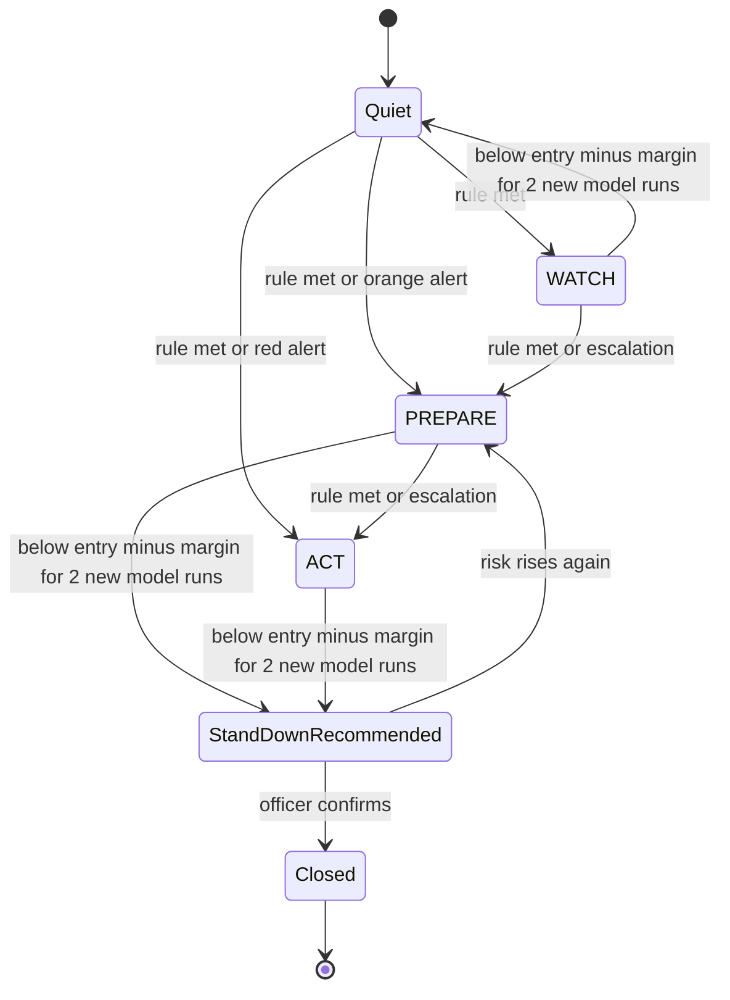
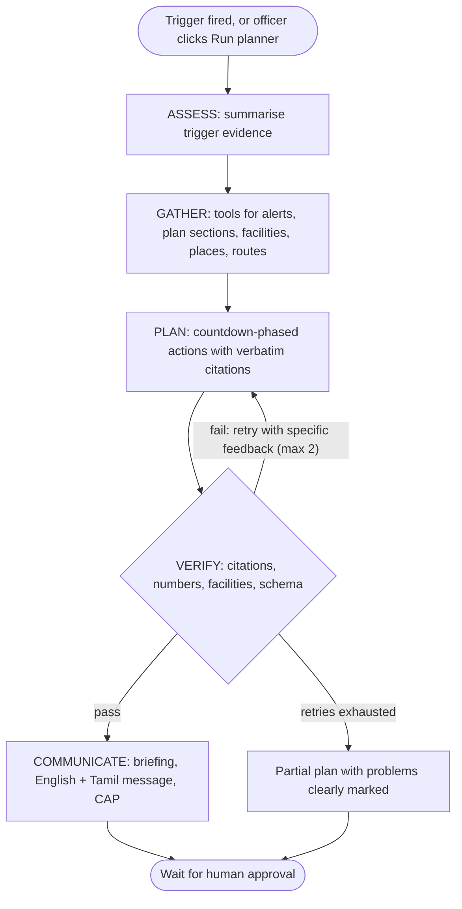
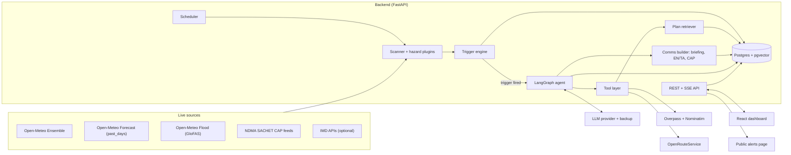
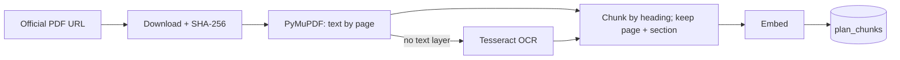

# T-Minus

**The anticipatory-action agent for district disaster management**

> **India forecasts well. T-Minus turns forecasts into action — before the disaster, not after.**

| | |
|---|---|
| **Event** | Forge Gen AI Buildathon · Theme 2: Climate, Resource Infrastructure & Global Supply Resilience |
| **Document type** | Product + technical specification (source of truth for implementation) |
| **Version** | v1.0 · 31 October 2026 |
| **Primary hazard** | Extreme rainfall and flooding · Tamil Nadu (Chennai first) |
| **Second hazard (stretch)** | Humid heat (Wet-Bulb Globe Temperature) |
| **Pitch in one breath** | 51 parallel forecasts → a real probability → a pre-agreed trigger → an agent that reads the district's own disaster plan → cited actions on a countdown → human approval |

---

## Contents

- [0. Read this first](#0-read-this-first)
- [1. Project name and overview](#1-project-name-and-overview)
- [2. Problem statement](#2-problem-statement)
- [3. Target users and user tasks](#3-target-users-and-user-tasks)
- [4. Core features](#4-core-features)
- [5. Inputs and data sources](#5-inputs-and-data-sources)
- [6. Processing rules and business logic](#6-processing-rules-and-business-logic)
- [7. Expected outputs and user experience](#7-expected-outputs-and-user-experience)
- [8. Error handling and edge cases](#8-error-handling-and-edge-cases)
- [9. Safety, privacy, constraints and integrations](#9-safety-privacy-constraints-and-integrations)
- [10. Acceptance criteria and test plan](#10-acceptance-criteria-and-test-plan)
- [11. System architecture](#11-system-architecture)
- [12. Data model](#12-data-model)
- [13. API surface](#13-api-surface)
- [14. Repository structure](#14-repository-structure)
- [15. Key decisions and trade-offs](#15-key-decisions-and-trade-offs)
- [16. Build plan and team ownership](#16-build-plan-and-team-ownership)
- [17. Demo script](#17-demo-script)
- [18. Risks and mitigations](#18-risks-and-mitigations)
- [19. Judging rubric map and judge Q&A](#19-judging-rubric-map-and-judge-qa)
- [20. Definition of done](#20-definition-of-done)
- [Appendix A: Glossary](#appendix-a-glossary)
- [Appendix B: References](#appendix-b-references)

---

## 0. Read this first

### 0.1 Instructions for the implementation team and AI coding assistants

Build a working, end-to-end application from this specification: a usable frontend, a backend, and the integration between them. Do not stop at mockups or pseudocode. Create the project structure, implement the workflows in §4 and §6, provide configuration examples, and document how to install, run, test and deploy. Where a requirement is missing, make a reasonable assumption and record it in `docs/assumptions.md`. Never hardcode secrets. Validate inputs, return useful errors, and write tests for critical behaviour (§10). Never claim an external action succeeded unless it did. Every consequential action requires explicit human confirmation.

Work in the order of §16 (build plan). Do not start a phase until the previous phase's exit criteria pass.

### 0.2 The five golden rules

> ⚠️ **These are non-negotiable. Breaking rule 1 disqualifies the project under the hackathon's zero-tolerance policy.**

1. **No mock data. Ever.** No hardcoded JSON, no sample datasets, no placeholder numbers, no "demo mode" with invented values. Every number shown in the app comes from a live API call or an official document, and displays its source and timestamp. When a source fails, show the failure; never invent a value. This rule overrides any generic template advice about "demo data" or "sample data".
2. **Code computes, the LLM reasons.** Probabilities, thresholds, lead times and statistics come from deterministic, unit-tested code. The LLM interprets evidence, retrieves, plans and explains. It never produces a number that code did not produce.
3. **Every recommendation is grounded.** Each action cites a page of an official plan with a verbatim quote, or is explicitly labelled *"Suggested — not in district plan."*
4. **Humans approve; the system never sends.** Nothing leaves T-Minus without an officer clicking Approve and confirming.
5. **Everyone can explain everything.** Code is modular and documented so that any team member can walk a judge through any module, the data flow and the AI logic.

### 0.3 Markers used in this document

- **MUST / STRETCH** — priority (see §4).
- **(verify)** — an external detail (endpoint, field name, coverage, limit) to confirm against official docs in Phase 0, before code depends on it.
- **Starting value** — a tunable parameter. It lives in config, its rationale is documented, and it is calibrated with replay (§6.10).

---

## 1. Project name and overview

**Name: T-Minus.** In a launch countdown, "T-minus 10" means ten seconds to lift-off. Every T-Minus trigger shows its own countdown to expected impact, and every recommended action is scheduled against that countdown.

**One-liner:** An AI agent that watches live probabilistic forecasts and, the moment a district's risk crosses a pre-agreed trigger, turns that district's own disaster plan into a cited, time-sequenced action plan — hours or days before impact.

**Overview:** T-Minus continuously monitors live, official forecast data: ensemble rainfall forecasts, river discharge forecasts and official IMD/NDMA alerts. When the probability of a dangerous event crosses a pre-defined trigger for a district, an AI agent reads that district's official Disaster Management Plan and produces:

- a **time-sequenced action plan** (what to do now, at T-48h, T-24h and T-6h before impact), where every action cites the plan;
- a **live map** of at-risk areas, shelters, hospitals and safe routes;
- **draft communications**: an officer briefing, a public message in English and Tamil, and a standards-compliant CAP alert.

Nothing is sent without human approval.

---

## 2. Problem statement

### 2.1 The gap between a warning and an action

India's forecasting has improved dramatically: the Bharat Forecasting System runs at ~6 km resolution, IMD issues district-level warnings, and NDMA's SACHET platform distributes official alerts. Yet disaster response remains largely reactive — mobilisation and relief typically ramp up after impact.

The bottleneck is the step between a warning and an action. When a district receives an orange or red warning, officials must manually interpret it, judge how likely and how severe the event really is, and search a 200–400 page District Disaster Management Plan for which shelters to open, which departments to alert and which low-lying areas to evacuate — under time pressure, often at night. **Forecast lead time, the most valuable resource in a disaster, gets wasted.**

The cost is measured in lives, homes, livelihoods and recovery budgets. Recent reminders: Cyclone Michaung (Chennai, December 2023) caused prolonged urban flooding, and the Wayanad landslides (July 2024) followed exceptionally heavy rainfall.

### 2.2 Precedent: anticipatory action works

The Red Cross / Red Crescent Movement's Forecast-based Financing approach defines triggers in advance — a danger level, a probability and a lead time — and links each trigger to a pre-agreed Early Action Protocol, so action starts as soon as a forecast crosses the trigger. It works, but each protocol is built manually, per country and per hazard.

### 2.3 Why existing tools don't close the gap

| Existing system | What it does well | What's missing → what T-Minus adds |
|---|---|---|
| IMD forecasts and district warnings | High-resolution forecasts, colour-coded district warnings | Says what weather is coming, not which of *this district's* plan actions to take, in what order → T-Minus links forecast to plan |
| NDMA SACHET | Disseminates official CAP alerts by geography and language | Alerts people; doesn't produce an operational plan for officials → T-Minus produces the plan and drafts CAP for approval |
| District Disaster Management Plans | Hazard analysis, SOPs, responsibility matrices | Static PDFs consulted manually under pressure → T-Minus retrieves the right page in seconds, with citations |
| Generic AI chatbots | Fluent answers | No live data, no triggers, no citations; can invent actions → T-Minus is grounded and verified |
| Red Cross Forecast-based Financing | Proven trigger → early-action model | Manual, per country, per hazard → T-Minus automates trigger evaluation and plan retrieval for every monitored district |

### 2.4 Outcome we want

Every monitored district gets automatic, probability-based triggers, and every trigger instantly produces an action plan grounded in that district's own official plan — converting forecast lead time into concrete early action.

---

## 3. Target users and user tasks

| User | Role | Core tasks |
|---|---|---|
| **District EOC duty officer / DDMA official** (primary) | Decides and coordinates district preparedness | See approaching hazards with probability, severity and time-to-impact; inspect the evidence behind each trigger; review the cited action plan; approve / edit / reject actions and alerts; export a one-page briefing for the District Collector; ask follow-up questions answered from the plan |
| **State coordinator** (SDMA / State EOC) | Oversees all districts | See every monitored district ranked by level and lead time; spot districts entering PREPARE or ACT; drill into any district |
| **City / zonal officer** (e.g., Greater Chennai Corporation) | Executes tasks on the ground | See vulnerable areas, shelters and safe routes for their zone, and the tasks assigned to their department |
| **Public** (indirect) | Receives alerts | Receive officer-approved alerts in plain English and Tamil, short enough for SMS |

**Primary user story.** *It's 11 pm. A district officer opens T-Minus and sees their district in PREPARE, about 31 hours from expected impact. In under five minutes they understand why, review a plan that cites their own DDMP page by page, edit two actions, approve the Tamil public message, and download the briefing for the Collector.*

**Not in scope:** a public forecasting app, a replacement for IMD, or anything that sends real alerts to the public or to government channels.

---

## 4. Core features

| ID | Feature | Priority | Description |
|---|---|---|---|
| F1 | Live risk scanner | MUST | On a schedule and on demand, fetch live ensemble forecasts for every monitored point and compute hazard probabilities (§6.2). |
| F2 | Probabilistic trigger engine | MUST | WATCH / PREPARE / ACT levels from danger threshold + probability + lead time; official-alert floors; escalation for saturated ground and compound hazards; stand-down with hysteresis (§6.4–6.6). |
| F3 | Agentic action planner | MUST | A LangGraph state graph that gathers evidence with tools, retrieves the district plan, drafts a countdown-phased action plan with verbatim citations, verifies itself and retries (§6.7–6.8). Runs automatically on a trigger, or manually for any district via **Run planner**. |
| F4 | Live reasoning trace | MUST | Every agent step and tool call streams to the UI in real time (§7). |
| F5 | Map dashboard | MUST | Districts coloured by level; at-risk areas from the plan; shelters, hospitals and schools from OpenStreetMap; safe routes avoiding at-risk zones. |
| F6 | Human-in-the-loop approval | MUST | Approve / edit / reject every action and communication; append-only audit log. |
| F7 | Communications drafts | MUST | Officer briefing (PDF), public message in English + Tamil, CAP 1.2 XML validated against the official schema (§6.9). |
| F8 | Sources panel + chaos switch | MUST | Status, last fetch and latency of every source; an admin-only fault-injection switch that disables a chosen source to demonstrate fallback live (§8.4). |
| F9 | Replay mode | MUST | Re-run the pipeline on a real past event using forecasts *as issued at the time*, clearly labelled, to measure the lead time T-Minus would have provided (§6.10). |
| F10 | Humid-heat plug-in (WBGT) | STRETCH | Same engine and agent, new hazard: Wet-Bulb Globe Temperature triggers heat-action steps (§6.11). Proves the framework generalises. |
| F11 | Plan Q&A | STRETCH | Officers ask questions; answers come only from the plan and live data, with citations. |
| F12 | Exposure estimate | STRETCH | Count of hospitals, schools and shelters inside at-risk areas. |
| F13 | Tamil voice briefing | STRETCH | Text-to-speech of the approved public message. |
| F14 | Telegram delivery | STRETCH | Approved public alerts posted to a Telegram channel the team owns. |
| F15 | Landslide plug-in | STRETCH | Rainfall-threshold triggers for hill districts. |

> **Why replay is MUST, not STRETCH:** if the weather is calm on demo day, nothing triggers live. Replay (real archived forecasts, clearly labelled) plus the manual **Run planner** keep the demo meaningful without ever faking data.

**Out of scope for the hackathon:** real SMS / SACHET / government integrations; training our own weather model; multi-tenant user management; high-frequency scanning of every Indian district (we monitor a configured set: all of Tamil Nadu plus a short watch-list of high-risk districts elsewhere).

---

## 5. Inputs and data sources

> Every source below is real and live. Details marked **(verify)** must be confirmed against official docs in Phase 0.

### 5.1 Live data

| Source | Provides | Used for | Auth | Notes |
|---|---|---|---|---|
| Open-Meteo **Ensemble API** (`ensemble-api.open-meteo.com/v1/ensemble`) | ECMWF IFS ensemble (51 members, ~15 days) and GFS ensemble; hourly precipitation, temperature, humidity, wind, radiation | Hazard probabilities (F1) | None | Per-member variables in the response (verify naming). The ECMWF ensemble updates every 6 h, so cache by model run. |
| Open-Meteo **Forecast API** (`api.open-meteo.com/v1/forecast`) | Deterministic high-resolution forecast; `past_days` | Display; rainfall over the last 72 h (antecedent conditions) | None | Use `past_days=3` for recent rain; the reanalysis archive lags by several days. |
| Open-Meteo **Flood API** (`flood-api.open-meteo.com/v1/flood`) | GloFAS v4 river discharge: 30-day forecast with ensemble statistics; reanalysis from 1984 | River trigger; each river point's own danger levels | None | ~5 km grid; points must sit on a modelled river (nudge ±0.1° if the response is null). |
| Open-Meteo **Single Runs / Previous Runs APIs** | Forecasts archived *as issued*, by model run time or lead-time offset | Replay mode only | None | Coverage varies by model and date (verify). Do **not** use the Historical Forecast API for replay (§6.10). |
| **NDMA SACHET** CAP RSS feeds (`sachet.ndma.gov.in`) | Official alerts from IMD, CWC, INCOIS and SDMAs | Escalation floor; cross-check | None | Per-state feeds with district-level areas. Find the Tamil Nadu feed URL on the portal (verify). |
| **IMD APIs** (`mausam.imd.gov.in`) | District warnings, district nowcast, district rainfall | Optional cross-check | IP whitelisting | Apply on day one. The app must work fully without IMD. |
| **Overpass API** (OpenStreetMap) | Hospitals, schools, shelters, fire and police stations | Map layers; facility verification | None | Cache per district; respect fair-use limits. |
| **Nominatim** (OpenStreetMap) | Geocoding of place names found in plans | Locating vulnerable areas | None | Max 1 request/s, custom User-Agent, cache every result (usage policy). |
| **OpenRouteService** Directions | Routing with `avoid_polygons` | Safe routes around at-risk areas | Free key | Keep avoid-polygons small and simple (verify size limits). |
| LLM provider + backup | Tool-calling reasoning | Agent | Key | One provider-agnostic interface (§9.4). |
| Translation (LLM, Bhashini or Sarvam) | Tamil text | Public messages | Key if external | Always human-reviewed before publishing. |

**Attribution in the UI footer:** "Weather data: Open-Meteo (CC BY 4.0)", "© OpenStreetMap contributors", "Routing: openrouteservice", plus each official source shown next to its data.

### 5.2 Official documents (knowledge base)

- **District Disaster Management Plans** published by the Tamil Nadu SDMA, and the **Greater Chennai Corporation City Disaster Management Perspective Plan**. Start with 3–5 districts whose PDFs have a clean text layer (e.g., Chennai, Chengalpattu, Nagapattinam), then expand.
- **NDMA national guidelines** (floods; heat waves) as generic fallback knowledge, always labelled *generic*.
- **Ingestion rules:** for every chunk keep document title, edition year, source URL, file SHA-256, page number and section heading. OCR pages without a text layer. Store the original text verbatim, never a paraphrase.

### 5.3 Geography

- District boundaries: an open GeoJSON dataset downloaded by a setup script from its published source; source and licence recorded in the README.
- Monitor points (config): each district's centroid plus up to three points on major rivers.

### 5.4 Configuration (parameters, not data)

`config/hazards.yaml` — every threshold carries its source or is marked as a starting value:

```yaml
rain:
  accumulation_window_h: 24
  categories_mm:                  # IMD 24-hour rainfall intensity categories
    heavy: 64.5
    very_heavy: 115.6
    extremely_heavy: 204.5
  levels:
    WATCH:   [{ category: very_heavy,      min_prob: 0.30, within_h: 120 }]
    PREPARE: [{ category: very_heavy,      min_prob: 0.50, within_h: 72 }]
    ACT:     [{ category: very_heavy,      min_prob: 0.70, within_h: 48 },
              { category: extremely_heavy, min_prob: 0.40, within_h: 72 }]
  official_alert_floor: { orange: PREPARE, red: ACT }
  escalation:
    antecedent_rain_72h_mm: 100   # starting value; calibrate with replay
    compound_with_river: true
  stand_down:
    prob_margin: 0.15             # stand down below (entry threshold - margin)
    consecutive_model_runs: 2
  min_valid_member_share: 0.8     # below 80% of the model's members valid -> degraded

river:
  baseline: { source: glofas_reanalysis, start: "1984-01-01", end: "2022-07-31" }
  levels:
    WATCH:   { statistic: ensemble_max,    above_percentile: 95, within_days: 7 }
    PREPARE: { statistic: ensemble_median, above_percentile: 95, within_days: 7 }
    ACT:     { statistic: ensemble_median, above_percentile: 99, within_days: 5 }
```

`config/districts.yaml` lists monitored districts, their aliases (e.g., Kancheepuram / Kanchipuram) and monitor points.

### 5.5 User inputs

| Input | Required | Validation |
|---|---|---|
| District + hazard (manual run) | Yes | Must match the official district list (fuzzy match + confirm) |
| Action / message edits | No | Length limits; English and Tamil Unicode; no HTML |
| Approve / reject decisions | Yes, to publish | Explicit confirmation dialog |
| Plan PDF upload | No | PDF only; size limit (starting value 30 MB); safe parsing; OCR if no text layer |
| Free-text question (F11) | No | Max length; answered only from the plan and live data |

---

## 6. Processing rules and business logic

### 6.1 Pipeline at a glance

1. **Scan** (deterministic code): fetch forecasts → compute per-hazard probabilities and lead times.
2. **Trigger** (deterministic code): map probabilities to WATCH / PREPARE / ACT; apply floors, escalation and hysteresis.
3. **Plan** (agent): gather evidence → retrieve plan sections → draft countdown-phased actions with citations → verify → retry if needed.
4. **Communicate** (agent drafts, code builds and validates): briefing, bilingual public message, CAP XML.
5. **Approve** (human): nothing leaves the system without an officer's confirmation.

### 6.2 Rainfall probability: the "51 futures" method

**Intuition.** Weather is chaotic: tiny errors in today's measurements grow into big differences a few days later. Instead of trusting one forecast, ECMWF runs its model 51 times from slightly perturbed starting states. Each run (a *member*) is one plausible future. The probability of an event is simply the share of futures in which it happens.

**Definitions.** For member *m* with hourly precipitation *p_m(t)*:

- Rolling 24-hour accumulation: `R_m(t) = p_m(t-23) + p_m(t-22) + ... + p_m(t)`
- Member *m* exceeds threshold *X* within window *W* if `max over t in W of R_m(t) >= X`
- Probability: `P(X, W) = (valid members that exceed) / (valid members)`

**Worked example.** N = 51 valid members, X = 115.6 mm (IMD *very heavy*), W = next 48 h. If 38 members show a 24-hour total of at least 115.6 mm somewhere in the window, then P = 38 / 51 = 0.745 → **74.5%**, which meets the ACT rule (≥ 70% within 48 h).

**Rules**

- Compute P separately for each level's window (`within_h`): the window is part of the trigger.
- Members with missing values in the window are excluded from numerator and denominator; record N. If fewer than `min_valid_member_share` of the model's members are valid, mark the assessment *degraded*.
- Display both forms, always: "74% (38 of 51 forecasts)".
- If the ECMWF ensemble is unavailable, fall back to the GFS ensemble (fewer members, so the display reads "x of N" with that model's N) and label the source (§8.1).

### 6.3 Lead time ("T-minus")

- **Expected impact time `t*`:** the forecast hour at which the share of members exceeding X is highest — the hour the futures agree on most.
- **T-minus:** `t* − now`, in hours.
- **Earliest plausible onset:** the first hour at which at least 10% of members exceed X. Shown as a secondary number for cautious planning.

### 6.4 River trigger (GloFAS)

- For each river point, compute daily-discharge percentiles P95 and P99 from GloFAS reanalysis (1984 → mid-2022), fetched once from the Flood API and stored with provenance (fetch id, period, computed time).
- Compare the forecast ensemble statistics (median, max) against those percentiles using the rules in `hazards.yaml`.
- **Caveat (shown in the UI):** GloFAS is a ~5 km global model. It represents large rivers far better than small urban channels such as Chennai's Adyar and Cooum. Urban flooding is driven mainly by intense rainfall, so **rainfall is the primary trigger and the river signal is supporting evidence.**

### 6.5 Level resolution (order matters)

1. **Base level** per hazard from the probability rules.
2. **Official floor:** an official orange alert for the district raises the level to at least PREPARE; red raises it to ACT (SACHET, plus IMD if available). Map each feed's CAP severity or colour code to orange / red, and verify which fields SACHET actually populates.
3. **Escalation, at most +1 level in total:**
   - *Saturated ground:* rainfall over the past 72 h ≥ `antecedent_rain_72h_mm`. Intuition: wet soil is a full sponge, so new rain runs off instead of soaking in.
   - *Compound hazard:* rain ≥ PREPARE and river ≥ WATCH in the same district.
4. **Cap** at ACT.
5. **Disagreement flag:** if the official alert and the ensemble differ by two or more levels, keep the more cautious level and flag "Sources disagree", showing both.

### 6.6 Trigger lifecycle, deduplication and stand-down



- **One trigger per (district, hazard, event window).** Level changes update the existing trigger (CAP `msgType` becomes `Update`); they never create a duplicate.
- **Downgrades** (e.g., ACT → PREPARE) follow the same hysteresis rule.
- **Hysteresis counts new model runs, not scans.** Re-scanning the same 6-hourly ensemble run must not count twice.
- **Stand-down is only a recommendation.** An officer closes the trigger (CAP `msgType = Cancel`).

### 6.7 The agent (LangGraph state graph)



**State object** (persisted per run): `trigger`, `assessment` (numbers from the scanner), `official_alerts`, `retrieved_chunks`, `facilities`, `geocodes`, `routes`, `draft_plan`, `verification_report`, `communications`, `errors`, `attempt`.

**Node responsibilities**

| Node | Does | Must not |
|---|---|---|
| ASSESS | Turns scanner output into a short evidence summary: levels, probabilities, T-minus, sources, disagreements | Recompute or re-round numbers produced by code |
| GATHER | Chooses tools and queries; handles tool errors by retrying, using another tool, or recording the gap | Call tools outside the registry or exceed the budget |
| PLAN | Drafts actions in phases anchored to `t*`; phases already passed collapse into **Do now**; each action gets a responsible department, locations and citations | Cite anything not returned by `retrieve_plan`; invent facilities |
| VERIFY | Runs the hard checks below (code), then an LLM critic pass for coherence and gaps | Pass a plan that fails any hard check |
| COMMUNICATE | Drafts briefing and messages; code builds and validates the CAP XML | Send or publish anything |

**Hard checks in VERIFY (code, not LLM)**

1. The output parses into the schema in §6.8.
2. Every action with `source = district_plan` has at least one citation, and each citation's `quote` is an **exact substring** of the cited chunk's text.
3. Every number in the plan text matches a number in the assessment (±0.5 tolerance for rounded percentages).
4. Every named facility exists in the plan chunks or in the OSM results for the district.
5. No action is phased later than `t*`.

On failure, VERIFY returns a specific list to PLAN, e.g., *"Action A4: quote not found on p. 117."*

**Budgets:** max 20 tool calls per run; max 3 PLAN attempts (initial + 2 retries); 120 s soft timeout. Every step is emitted to the trace.

**Tool registry**

| Tool | Input | Output | Notes |
|---|---|---|---|
| `get_assessment` | district_id, hazard | levels, probabilities, N members, T-minus, onset, sources + timestamps | Read-only; the scanner's stored results |
| `get_official_alerts` | district_id | alerts: agency, severity, issued, expires, text | SACHET; IMD if available |
| `retrieve_plan` | district_id, query, k | chunks: chunk_id, document, page, section, text, score | Hybrid search (vector + keyword); returns `not_found` below the score threshold |
| `get_generic_guidance` | hazard, query | NDMA guideline chunks | Always flagged `generic` |
| `find_facilities` | district_id, types | OSM features: id, name, type, lat, lon | Cached per district |
| `geocode_place` | name, district_id | lat, lon, confidence, osm_id — or `not_found` | Nominatim, bounded to the district |
| `compute_safe_route` | origin, destination, avoid_area_ids | geometry, distance, duration, avoided areas | OpenRouteService `avoid_polygons` |

The LLM receives computed summaries, never raw 51-member arrays (cost and accuracy).

### 6.8 Output schema (illustrative shape only — never used as app data)

```python
class Citation(BaseModel):
    document_id: str
    document_title: str
    page: int
    chunk_id: str
    quote: str                       # verbatim substring of the chunk, <= 300 chars

class ActionItem(BaseModel):
    id: str
    phase: Literal["Do now", "T-48h", "T-24h", "T-6h"]
    action: str
    responsible: str | None          # department, from the plan's responsibility matrix
    location_refs: list[str] = []    # OSM ids or geocoded plan places
    source: Literal["district_plan", "generic_guidance", "suggested"]
    citations: list[Citation] = []   # required unless source == "suggested"
    rationale: str
    status: Literal["proposed", "approved", "edited", "rejected"] = "proposed"

class ActionPlan(BaseModel):
    trigger_id: str
    district_id: str
    hazard: Literal["rain", "river", "heat"]
    level: Literal["WATCH", "PREPARE", "ACT"]
    generated_at: datetime
    evidence_summary: str
    key_numbers: dict[str, float]    # copied from get_assessment, never computed by the LLM
    actions: list[ActionItem]
    open_questions: list[str]        # what the officer must decide or verify
    warnings: list[str]              # degraded data, disagreements, missing plan sections
```

### 6.9 Communications

- **Officer briefing** (one page, PDF): situation; evidence with numbers, sources and timestamps; actions by phase with citations; open questions; data warnings.
- **Public message:** plain language, no jargon, one clear instruction. English ≤ 160 characters (one SMS). Tamil ≤ 134 characters (two Unicode SMS segments: Unicode SMS holds 70 characters in a single message and 67 per segment when concatenated). Live character and segment counters.
- **Probability wording**, always shown with the number: ≥ 70% "very likely"; above 50% "likely"; 30–50% "possible". Below 30%, no public message is drafted.
- **CAP 1.2 XML**, built by code from approved content and validated against the OASIS CAP 1.2 XSD:

| CAP element | T-Minus value |
|---|---|
| `status` | `Exercise` in this prototype — never `Actual` |
| `msgType` | `Alert` on the first trigger; `Update` on a level change; `Cancel` on officer-confirmed stand-down |
| `scope` | `Public` |
| `info/category` | `Met` |
| `info/event` | e.g., "Very heavy rainfall" |
| `info/urgency` | `Future` when impact is more than ~1 h away; `Expected` within the next hour; `Immediate` when ongoing |
| `info/severity` | Heavy → `Moderate`; Very heavy → `Severe`; Extremely heavy → `Extreme` |
| `info/certainty` | CAP's own definitions: P > 50% → `Likely`; P ≤ 50% → `Possible` |
| `info/onset`, `info/expires` | Earliest plausible onset; end of the event window |
| `info/headline`, `description`, `instruction` | Approved English text; Tamil in a second `info` block with `language="ta-IN"` |
| `area/areaDesc`, `area/polygon` | District name; simplified district boundary |

### 6.10 Replay mode (backtesting without look-ahead bias)

- **Goal:** answer "how many hours of warning would T-Minus have given?" for a real past event, using only information that existed at the time.
- **Rule: forecasts as issued.** Use the Single Runs API or Previous Runs API (verify model and date coverage). **Never use the Historical Forecast API for replay:** it stitches together the first hours of each model run, which is close to what actually happened, so it would leak the future into the past and inflate the lead time.
- **Event choice:** Cyclone Fengal (late November – early December 2024, landfall near Puducherry) is the primary candidate, because archived as-issued high-resolution runs exist from 2024 (verify). Use Cyclone Michaung (December 2023) only if as-issued archives cover it.
- **Probability in replay:** if archived ensemble members exist for the event, use §6.2 unchanged. Otherwise compute **multi-model agreement** (share of archived models/runs exceeding the threshold) and label it as such; it is not identical to a live ensemble probability.
- **Ground truth:** observed rainfall from the Open-Meteo reanalysis archive for the event window, plus official records cited in the README.
- **Output:** a timeline showing when WATCH, PREPARE and ACT would have fired relative to peak rainfall, plus a false-alarm check over a quiet period of the same length.
- **Calibration:** replay several events and quiet periods to tune starting values (hits vs false alarms). Record the results in `docs/decisions.md`.
- **Isolation:** a persistent banner reads "REPLAY · real forecasts as issued at the time". Replay never writes to the live triggers table.

### 6.11 Humid-heat plug-in (STRETCH)

- **Why it matters:** sweat cools the body only when it evaporates. In humid air evaporation stalls, so humid heat at 36 °C can be more dangerous than dry heat at 42 °C. WBGT captures this; air temperature alone does not.
- **Metric:** outdoor WBGT = 0.7·Tw + 0.2·Tg + 0.1·Ta (natural wet-bulb, globe and air temperature), estimated from forecast temperature, humidity, wind and solar radiation with the Liljegren et al. (2008) method. An open-source implementation is acceptable; cite it.
- **Probability:** share of ensemble members whose daily maximum WBGT reaches each band.
- **Bands (starting values from the US Army TB MED 507 heat categories; confirm and cite):** WATCH ≥ 29.4 °C; PREPARE ≥ 31.1 °C; ACT ≥ 32.2 °C.
- **Knowledge:** state and city Heat Action Plans and NDMA heat-wave guidelines (cooling centres, shifted outdoor work hours, hydration points, hospital readiness).
- **Implementation:** one new plugin; the trigger engine, agent, UI and communications are reused unchanged.

```python
class HazardPlugin(Protocol):
    name: str                                             # "rain", "river", "heat"
    def fetch(self, points: list[Point]) -> RawForecast: ...
    def assess(self, raw: RawForecast, cfg: HazardConfig) -> Assessment: ...
    def plan_query_hints(self, level: Level) -> list[str]: ...   # e.g. "relief camps", "evacuation"
```

### 6.12 AI behaviour rules

- The LLM never computes probabilities, thresholds or statistics.
- Retrieved text (PDFs, RSS, web pages) is **data, not instructions**. The system prompt says so, and tool outputs are wrapped as quoted data.
- When the plan doesn't cover something, the agent says *"Not found in district plan"*, may add labelled generic guidance, and lists the gap under `open_questions`.
- Language is calm, specific and action-first. No speculation about casualties.
- Every output carries the timestamps of the data it used.

---

## 7. Expected outputs and user experience

### 7.1 Visual style

An emergency-operations-centre look: dark theme by default (light theme available), high contrast, and risk colours green / yellow / orange / red **always paired with an icon and a text label**, never colour alone. A clean sans-serif plus Noto Sans Tamil. Responsive from laptop to phone.

### 7.2 Screens

| Screen | Contents |
|---|---|
| **Command map** (home) | Tamil Nadu map (zoom out to India for the watch-list); districts coloured by level; ACT districts pulse. Side panel ranks districts by level, then by T-minus, with a live countdown. Header shows the last scan time. |
| **District view** | Hazard cards, e.g., "Very heavy rain · 74% (38 of 51 forecasts) · expected in ~31 h · earliest onset ~22 h". **Futures chart:** each member's 24-h accumulation as a faint line, the threshold as a bold line, the impact window shaded. River discharge chart against P95/P99. Official alerts with agency and time. *Degraded* and *Sources disagree* badges. |
| **Live agent trace** | Streams each step and tool call with timing, e.g., `retrieve_plan("relief camps flood") → 6 chunks, pp. 112–131`. Errors and retries are visible, not hidden. |
| **Action timeline** | Columns: Do now · T-48h · T-24h · T-6h. Each card: action, responsible department, citation chip (opens the quote and page), source badge (Plan / Generic / Suggested), Approve · Edit · Reject. |
| **Map layers** | At-risk areas from the plan (geocoded; unresolved names listed separately), shelters / hospitals / schools from OSM, safe routes avoiding at-risk zones. |
| **Communications** | Briefing preview + PDF export; English and Tamil messages with character and segment counters; CAP XML with a schema-validation badge; **Approve & publish** behind a confirmation dialog. |
| **Sources panel** | Per source: status (live / stale / failed / simulated outage), last fetch, latency, model run time. Admin-only chaos switch (§8.4). |
| **Public alerts page** | Read-only list of approved alerts, labelled as a prototype exercise. |
| **Replay** | The same UI with a persistent replay banner and an event timeline. |

### 7.3 States

- **Loading:** skeletons that name what is being fetched ("Fetching ECMWF ensemble…").
- **All clear:** "No monitored district above WATCH · last scan 14:30 IST". A real, valid live state — shown proudly.
- **Stale / degraded:** amber banner naming the source and the age of its data.
- **Error:** what failed, what the system did about it, and what the officer can do.

### 7.4 Notifications

In-app toast and badge when a district enters PREPARE or ACT, or when sources disagree.

---

## 8. Error handling and edge cases

### 8.1 Data sources

| Situation | Behaviour |
|---|---|
| Timeout / 5xx / rate limit | Exponential backoff, 3 attempts; then the alternate source (ECMWF ensemble → GFS ensemble; IMD → SACHET), recorded in the sources panel |
| All sources for a hazard fail | Show the last successful real reading with "STALE · last updated HH:MM". Never fabricate or interpolate. No new triggers on data older than 6 h (starting value); show "insufficient data" |
| Missing hours or members | Compute from valid members only; show N; mark *degraded* below `min_valid_member_share`; never treat missing as zero |
| River point returns null discharge | Try points ±0.1°; if still null, mark the point "not on a modelled river" and continue without it |
| Malformed response | Validate every response against a per-source schema; reject, log, treat as a failure |
| SACHET feed unreachable | Continue on the ensemble alone; flag "official alerts unavailable" |

### 8.2 Agent and LLM

| Situation | Behaviour |
|---|---|
| Tool error | The agent sees the error and retries or picks another tool; the trace shows it |
| Invalid output (schema, missing or non-verbatim citation, mismatched number) | VERIFY rejects with specific feedback; max 2 retries; then a partial plan with problems marked |
| Low retrieval score | "Not found in district plan"; labelled NDMA generic guidance; gap added to open questions |
| District without a plan | As above, plus a prompt to upload the plan |
| Conflicting sources | Flag, show both, use the more cautious level |
| LLM provider outage | Switch to the backup model; if none, the scanner, triggers and map keep working and the planner shows "temporarily unavailable" |
| Instructions embedded in a PDF or feed | Treated as data; tool outputs are wrapped and the system prompt forbids following embedded instructions |

### 8.3 User input

| Situation | Behaviour |
|---|---|
| Unknown or misspelt district | Fuzzy-match against the official list and aliases; ask to confirm |
| Non-PDF, oversized or encrypted upload | Reject with a clear message |
| Scanned PDF without text | OCR; flag low-confidence pages for review |
| Empty, off-topic or abusive question | Polite refusal; answers come only from the plan and live data |
| Edit that exceeds SMS length | Counter turns red; publishing is blocked until fixed |

### 8.4 System

| Situation | Behaviour |
|---|---|
| Duplicate trigger | Deduplicate by district + hazard + event window (§6.6) |
| SSE connection drops | Auto-reconnect and resume from the last event id |
| Chaos switch (admin only) | Forces a chosen source client to fail so the fallback path can be demonstrated live. Each forced failure is labelled "simulated outage" in the sources panel and logs. Disabled for non-admin users. |
| Scheduler crash | The health endpoint reports it; the next request triggers a catch-up scan |

---

## 9. Safety, privacy, constraints and integrations

### 9.1 Hackathon compliance (non-negotiable)

- No mock, sample, placeholder or hardcoded data anywhere in the application. The only data-like files in the repository are configuration (§5.4) and the OASIS CAP 1.2 XSD. Plan PDFs and district boundaries are downloaded by setup scripts from their official or published sources.
- Fallbacks only ever show the last real value with its timestamp.
- Replay uses real forecasts, archived as issued and fetched from a live API, and is always labelled.
- All core logic is written during the hackathon window; open-source libraries are allowed.
- Every member can explain every module (§19.2).

### 9.2 Safety

- T-Minus never publishes or sends anything automatically. Every action and communication requires an officer's explicit approval, and every decision is written to an append-only audit log (who, what, when, text before and after).
- In this prototype, "publish" posts only to the app's own public alerts page (stretch: a Telegram channel the team owns). It never sends to real government systems, SMS gateways or SACHET, and CAP `status` is always `Exercise`.
- T-Minus is labelled as a decision-support tool, not an official warning source. Every number and recommendation shows its source.
- Retrieved text is data, never instructions (prompt-injection protection).

### 9.3 Privacy and security

- No personal data about the public is collected. Officer accounts store only a display name and role.
- Secrets live in environment variables; `.env.example` lists names only.
- Officer actions require login; the public page is read-only. CORS is limited to the frontend origin; write endpoints are rate-limited.

### 9.4 Technology choices

| Layer | Choice | Why |
|---|---|---|
| Backend | Python 3.11+, FastAPI, Pydantic | Async I/O for many API calls; typed models end to end |
| Agent | LangGraph | Explicit state graph: inspectable nodes, retries, persistence, streaming |
| LLM | A tool-calling model (e.g., Claude, Gemini or GPT) behind one interface, plus a backup | No lock-in; survives provider outages |
| Retrieval | PyMuPDF (+ Tesseract OCR), embeddings, pgvector (or Chroma), hybrid vector + keyword search | Page-accurate citations; keyword search catches place and department names that embeddings miss |
| Database | Postgres (e.g., Supabase) | Triggers, runs, approvals, audit log and vectors in one place |
| Scheduling | APScheduler (in-process) or cron | Simple and sufficient at hackathon scale |
| Frontend | React / Next.js, MapLibre GL or Leaflet, a charting library | Map-first UI with smooth layers |
| Streaming | Server-Sent Events | One-way live trace; simpler than WebSockets |
| PDF export | Server-side HTML → PDF | Consistent briefing layout |
| Deployment | Frontend on Vercel; backend in Docker on Render / Railway / Hugging Face Spaces | Free tiers and a public URL for judging |

### 9.5 Budget and rate limits

- Free tiers only.
- Batch coordinates per request where the API allows it. Cache by model run (ensemble), 10 min (SACHET), 24 h (OSM facilities), permanently (geocodes, river baselines). Respect each provider's fair-use policy.
- Must-haves first; stretch work only after the core passes its acceptance tests.

---

## 10. Acceptance criteria and test plan

### 10.1 Acceptance criteria

| ID | Scenario | Pass condition |
|---|---|---|
| AC-01 | Live scan | For ≥ 10 monitored districts a scan completes in < 60 s; each shows a level and a "last updated" time traceable to a logged real API call |
| AC-02 | Probability correctness | For one district, the displayed probability equals (members above threshold ÷ valid members), recomputed by hand from the stored raw response |
| AC-03 | Trigger creation | Crossing PREPARE creates exactly one trigger; the next scan does not duplicate it; it appears on the map within one scan cycle |
| AC-04 | Grounding | 100% of plan actions either carry a citation whose quote is an exact substring of the cited page text, or are labelled "Suggested — not in district plan" |
| AC-05 | No invented facilities | Every named shelter or hospital exists in the plan chunks or the OSM results |
| AC-06 | Source failure | Chaos switch on the primary forecast source → no crash, backup source used, sources panel shows the failure. All sources off → stale banner and no new triggers |
| AC-07 | Missing plan | Running the agent for a district without a plan returns "no district plan available" and labelled NDMA generic guidance |
| AC-08 | Approval gate | No action or message reaches the public page without Approve + confirmation; the audit log records it |
| AC-09 | CAP validity | Generated CAP XML validates against the OASIS CAP 1.2 XSD, with `status = Exercise` |
| AC-10 | Bilingual message | English ≤ 160 characters and Tamil ≤ 134 characters, both present and editable |
| AC-11 | Stand-down | Two consecutive new model runs below (entry − margin) produce a stand-down recommendation, never an automatic close |
| AC-12 | Replay | Replay on the chosen event, using as-issued archives, reports when WATCH / PREPARE / ACT would have fired relative to peak rainfall (target: PREPARE ≥ 24 h ahead), plus a quiet-period false-alarm check |
| AC-13 | Live trace | Every agent step and tool call appears in the UI within 2 s |
| AC-14 | Garbage input | Empty question, unknown district, 50 MB upload, non-PDF upload → clear messages and no crash |

### 10.2 Test strategy

| Level | What | Examples |
|---|---|---|
| Unit (many, fast) | Pure functions | Rolling accumulation; probability; T-minus; level resolution and the +1 escalation cap; hysteresis counted by model run; SMS segment counter; CAP builder; verbatim-citation checker |
| Integration (some) | Each source client against the live API with schema validation; retrieval returns the right pages for known questions; one full agent run per hazard | `test_open_meteo_ensemble_live`, `test_retrieve_relief_camps_chennai` |
| End-to-end (few) | Browser flows | Trigger → plan → edit → approve → public page; replay end to end |
| Chaos | Forced failures via the chaos switch | AC-06 |

Unit tests for pure functions may use small inline arrays defined inside `tests/`. They never ship in application code and are never displayed in the app.

---

## 11. System architecture



**Plan ingestion pipeline**



**Data flow for one trigger:** scheduler → scanner fetches ensemble, flood and alert data → trigger engine stores the assessment and opens or updates a trigger → an agent run starts and streams its events → plan and communications are stored as *proposed* → an officer approves → the approved message appears on the public page and in the CAP output.

**Scale note:** cost grows with the number of monitored points, not with users. Forecasts are fetched once per model run and shared by every viewer.

---

## 12. Data model

| Table | Key fields |
|---|---|
| `districts` | id, name, state, aliases[], boundary (GeoJSON), centroid |
| `monitor_points` | id, district_id, kind (centroid / river), lat, lon, river_name |
| `source_fetches` | id, source, request_params, fetched_at, model_run_time, status, http_code, latency_ms, raw_payload (JSONB), error, simulated (bool) |
| `assessments` | id, district_id, hazard, computed_at, model_run_time, n_members, probabilities (JSONB), level, t_minus_h, onset_h, degraded, fetch_ids[] |
| `river_baselines` | point_id, p95, p99, period_start, period_end, computed_at, fetch_id |
| `triggers` | id, district_id, hazard, level, status (active / stand_down_recommended / closed), window_start, window_end, opened_at, updated_at, history (JSONB) |
| `plan_documents` | id, district_id, title, edition_year, source_url, sha256, pages, ingested_at |
| `plan_chunks` | id, document_id, page, section, text, embedding |
| `agent_runs` | id, trigger_id, started_at, finished_at, status, model, attempts, tool_calls, tokens |
| `agent_events` | id, run_id, seq, ts, type (step / tool_call / tool_result / retry / error), payload |
| `action_items` | id, run_id, phase, action, responsible, source, citations (JSONB), status, edited_text |
| `communications` | id, run_id, kind (briefing / public_en / public_ta / cap), content, valid, status |
| `approvals` | id, target_type, target_id, decision, before, after, user, ts — append-only |
| `public_alerts` | id, communication_id, published_at |
| `geocodes` | name, district_id, lat, lon, confidence, osm_id, fetched_at |

`source_fetches.raw_payload` makes every number on screen traceable to the exact API response it came from. That is how AC-02 is checked, and how to answer any judge who asks "is this real?"

---

## 13. API surface

| Method | Path | Purpose |
|---|---|---|
| GET | `/api/health` | Liveness, scheduler status, last scan |
| GET | `/api/sources` | Per-source status, last fetch, latency |
| POST | `/api/admin/chaos` | Toggle a simulated outage for one source (admin only) |
| GET | `/api/districts` | All monitored districts with current level and T-minus |
| GET | `/api/districts/{id}` | Full assessment, official alerts, futures-chart series |
| POST | `/api/scan` | Run a scan now |
| GET | `/api/triggers?status=active` | Active triggers |
| POST | `/api/districts/{id}/plan` | Start an agent run manually → `run_id` |
| GET | `/api/runs/{run_id}/events` | SSE stream of the agent trace |
| GET | `/api/runs/{run_id}` | Plan, verification report, communications |
| PATCH | `/api/actions/{id}` | Approve / edit / reject an action |
| POST | `/api/communications/{id}/approve` | Approve and publish (confirmation token required) |
| GET | `/api/communications/{id}/cap.xml` | Validated CAP XML |
| GET | `/api/public/alerts` | Public read-only feed |
| POST | `/api/plans` | Upload a plan PDF for a district |
| POST | `/api/replay` | Start a replay for an event |
| POST | `/api/ask` | Plan Q&A (stretch) |

All errors share one shape: `{ "error": { "code": "...", "message": "...", "source": "...", "retryable": true } }`.

---

## 14. Repository structure

```text
t-minus/
├── README.md                 # what, quick start, run/test/deploy, architecture diagram, sources + licences
├── SPEC.md                   # this document
├── .env.example
├── docker-compose.yml
├── config/
│   ├── hazards.yaml          # thresholds with sources (§5.4)
│   └── districts.yaml        # monitored districts, aliases, monitor points
├── docs/
│   ├── architecture.png      # exported from the Mermaid diagrams
│   ├── assumptions.md
│   └── decisions.md          # §15, kept up to date
├── backend/
│   ├── app/
│   │   ├── main.py
│   │   ├── api/              # districts, triggers, runs, approvals, public, plans, replay, admin
│   │   ├── sources/          # open_meteo, glofas, sachet, imd, overpass, nominatim, ors (+ retry, cache, schemas)
│   │   ├── hazards/          # base.py (HazardPlugin), rain.py, river.py, heat.py
│   │   ├── triggers/         # levels.py, escalation.py, lifecycle.py
│   │   ├── agent/            # graph.py, nodes/, tools.py, prompts/, schemas.py, verify.py
│   │   ├── rag/              # ingest.py, ocr.py, chunker.py, embed.py, retrieve.py
│   │   ├── comms/            # briefing.py, messages.py, sms.py, cap.py, xsd/ (OASIS CAP 1.2)
│   │   ├── replay/           # runner.py
│   │   ├── db/               # models.py, migrations/
│   │   └── scheduler.py
│   ├── scripts/              # ingest_plans.py, compute_river_baselines.py, fetch_boundaries.py
│   └── tests/                # unit/, integration/, e2e/
└── frontend/
    └── src/
        ├── pages/            # map, district, run, comms, sources, public, replay
        ├── components/       # MapView, HazardCard, FuturesChart, AgentTrace, ActionTimeline, CommsPanel, SourcesPanel, ReplayBanner
        ├── lib/              # API client, SSE client
        └── i18n/             # en, ta
```

---

## 15. Key decisions and trade-offs

| Decision | Alternative | Why this way | Revisit when |
|---|---|---|---|
| Probabilistic triggers from ensembles | One deterministic forecast | Exposes real uncertainty; matches how anticipatory-action triggers are designed; explainable ("38 of 51") | Never for triggers; deterministic stays for display |
| Code computes, LLM reasons | Let the LLM read raw data | Testable numbers; no arithmetic hallucinations; lower cost | — |
| District plans as the source of actions | LLM general knowledge | Officials trust their own SOPs; citations are checkable | A plan is missing → labelled generic guidance |
| LangGraph state graph | One big prompt or a free-form agent loop | Explicit, inspectable steps; reliable retries; streamable | — |
| Hybrid retrieval | Pure vector search | Place and department names need keyword matching | — |
| Rainfall primary, river supporting | River primary | GloFAS (~5 km) is weak on small urban channels; urban floods are rain-driven | Better local river data becomes available (e.g., CWC) |
| Human approval for everything | Auto-send at ACT | Safety, accountability and trust | Never in this prototype |
| SSE for the trace | WebSockets | One-way stream; simpler; proxy-friendly | Two-way collaboration is needed |
| Monitored set (Tamil Nadu + watch-list) | Every district nationwide | Fits free-tier limits; depth over breadth | A paid tier or our own data mirror |

---

## 16. Build plan and team ownership

### 16.1 Phases (each ends with tests passing, not "mostly works")

| Phase | Deliverable | Exit criteria |
|---|---|---|
| 0 · Setup | Repo and CI; accounts and keys; IMD whitelisting requested; plan PDFs located; replay archive coverage checked and event chosen; every **(verify)** item confirmed | `docker compose up` runs the skeleton; all keys valid; verification notes in `docs/assumptions.md` |
| 1 · Data spine | Source clients, rain probability, river baselines, sources panel | AC-01, AC-02 |
| 2 · Triggers + map | Trigger engine and lifecycle; command map; district view; futures chart | AC-03, AC-11 |
| 3 · Plans + agent | Ingestion, hybrid retrieval, LangGraph agent, VERIFY, live trace | AC-04, AC-05, AC-07, AC-13 |
| 4 · Approve + communicate | Approvals, audit log, briefing PDF, EN/TA messages, CAP | AC-08, AC-09, AC-10 |
| 5 · Harden + replay + deploy | Chaos switch, fallbacks, replay, deployment | AC-06, AC-12, AC-14; the public URL works from a phone |
| 6 · Stretch | Heat plug-in first, then F11–F15 | Only after every AC passes |
| 7 · Submission | README with diagram, 2–3 minute video, 5–7 slide deck | Checklist in §20 |

Confirm with the organisers which setup work (accounts, keys, collecting official PDFs) is allowed before the hackathon window opens. All core logic is written inside the window.

> **Feature freeze at ~75% of the hackathon window.** The last quarter is for breaking the demo on purpose and fixing what breaks. Live demo robustness is worth 30 of the 100 points.

### 16.2 Ownership (adapt to team size; merge roles if there are fewer people)

| Owner | Modules | Also owns |
|---|---|---|
| A · Data & triggers | `sources/`, `hazards/`, `triggers/`, scheduler, river baselines | AC-01–03, AC-06, AC-11 |
| B · Agent & retrieval | `rag/`, `agent/`, VERIFY | AC-04, AC-05, AC-07, AC-13 |
| C · Frontend & map | All of `frontend/` | Demo-flow polish, accessibility |
| D · Platform & comms | `comms/`, approvals, database, deployment, CI, replay | AC-08–10, AC-12, README, video |

Before the feature freeze, every owner gives the others a 10-minute walkthrough of their module (golden rule 5).

---

## 17. Demo script

### 17.1 Video (2–3 minutes; the real system, running end to end)

| Time | Show | Say |
|---|---|---|
| 0:00 | Title; a Chennai flood reference | "India knows the storm is coming. Districts still act after it hits." |
| 0:15 | Command map; sources panel with live timestamps | "Every number here comes from a live official source. Here's when each one was fetched." |
| 0:35 | District view; futures chart | "ECMWF runs 51 versions of the future. In 38 of them, this district crosses IMD's 'very heavy' line within two days. That's our trigger." |
| 1:00 | Run planner; live agent trace | "The agent is now reading this district's own disaster plan." |
| 1:25 | Action timeline; open a citation | "Every action cites the page it came from. If it isn't in the plan, it says so." |
| 1:50 | Edit and approve; Tamil message; CAP validation badge | "Nothing leaves without an officer's approval — in Tamil and English, in the national alert standard." |
| 2:10 | Chaos switch on the primary source | "Watch what happens when a data source dies." |
| 2:25 | Replay timeline | "On a real past cyclone, using only forecasts that existed at the time, T-Minus would have fired PREPARE [N] hours before peak rain." |
| 2:45 | Close | "India forecasts well. T-Minus turns forecasts into action." |

The numbers spoken in the video come from the live screen and from AC-12. Use the real value of N; never round it up.

### 17.2 Live judging

- Open with the sources panel to show the data is live.
- If no district is above WATCH, show the all-clear state (it's real), run the planner manually on a district, then show replay.
- Keep a second tab open on `/api/health`.
- Never present a recording as the live system.

---

## 18. Risks and mitigations

| Risk | Likelihood | Impact | Mitigation |
|---|---|---|---|
| Calm weather on demo day | High | High | Wider watch-list; manual Run planner; replay; an honest all-clear state |
| IMD whitelisting not granted in time | Medium | Low | IMD is optional by design; SACHET + Open-Meteo cover the need |
| Replay leaks the future (look-ahead bias) | Medium | High | As-issued archives only (§6.10), documented in the README |
| Messy or scanned plan PDFs | High | Medium | OCR; start with 3–5 clean plans; spot-check pages |
| LLM invents actions or facilities | Medium | High | Verbatim-quote check, facility check, schema validation, critic loop |
| API outage or rate limit during judging | Medium | High | Caching by model run; batching; backup sources; chaos-tested fallbacks |
| Geocoding mismatches for plan place names | Medium | Medium | Search bounded to the district; confidence threshold; unresolved names listed separately |
| GloFAS weak on small urban rivers | High | Low | Rainfall is primary; river shown as supporting evidence with a caveat |
| Tamil translation errors | Medium | Medium | Native-speaker review step; glossary of key terms |
| Scope creep | High | High | MUST / STRETCH discipline; feature freeze at 75% |
| A member can't explain a module | Medium | High | Module walkthroughs; Q&A drill (§19.2) |

---

## 19. Judging rubric map and judge Q&A

### 19.1 How T-Minus maps to the rubric

| Pillar (points) | What judges look for | Where T-Minus delivers |
|---|---|---|
| Technical depth (20) | Beyond wrappers: custom RAG, state graphs, clean modular code | Hazard plugins, ensemble maths, hybrid retrieval with page-level citations, LangGraph agent, CAP builder, typed API |
| AI reasoning & agentic execution (25) | Multi-step tool use, error handling, self-correction, low hallucination, source attribution | Tool-calling agent; VERIFY loop with verbatim-citation checks; retries visible in the live trace |
| Relevance, impact & USP (25) | A real problem, clear differentiation | Closes the warning-to-action gap; automates anticipatory action for every monitored district; grounded in each district's own plan |
| Live demo & robustness (30) | Runs live; handles bad input and network failures | Sources panel; chaos switch; stale handling; all-clear state; replay; garbage-input tests |

### 19.2 Questions every team member should be able to answer

1. **"Why not just use IMD's warnings?"** We do: they set the minimum level. IMD says what weather is coming; T-Minus tells a district what to do and when, from its own plan, with an explicit probability.
2. **"Why 51 forecasts?"** Weather is chaotic, so a single forecast hides its uncertainty. Counting how many of 51 perturbed runs cross the threshold gives a real probability, which is what anticipatory-action triggers are built on.
3. **"What about false alarms?"** Tiered levels, hysteresis counted in new model runs, stand-down recommendations, human approval, and thresholds tuned by replaying past events and quiet periods.
4. **"Can the LLM invent a shelter?"** Every cited quote must be an exact substring of the retrieved page, every facility must exist in the plan or OpenStreetMap, and failures loop back with specific feedback.
5. **"Why doesn't the LLM calculate the probability?"** Arithmetic belongs in tested code. The LLM is good at reading, planning and explaining.
6. **"Is any of this data fake?"** No. Open the sources panel and the raw fetch log: every number links to the API response it came from. Replay uses forecasts exactly as they were issued at the time.
7. **"What if an API dies mid-demo?"** Flip the chaos switch and watch the fallback.
8. **"Who's responsible if it's wrong?"** The officer. T-Minus is decision support: it drafts, cites and explains; humans decide, and every decision is logged.
9. **"How does this scale to all of India?"** A new district is a plan PDF plus config entries; a new hazard is one plugin. Cost scales with monitored points, not users.

---

## 20. Definition of done

**Product**

- [ ] All MUST features (F1–F9) work end to end on the deployed URL
- [ ] Acceptance criteria AC-01 to AC-14 pass, with evidence (screenshots or logs) in `docs/`
- [ ] No mock data anywhere; every displayed number is traceable to `source_fetches`
- [ ] Nothing can be published without approval; the audit log is complete

**Repository**

- [ ] README: what it is, quick start (< 10 minutes), environment variables, run / test / deploy commands, architecture diagram, data sources and licences, known limitations
- [ ] `.env.example` with variable names only
- [ ] `docs/decisions.md` and `docs/assumptions.md` up to date

**Forge submission**

- [ ] Problem statement and solution description
- [ ] Live deployment URL
- [ ] 2–3 minute demo video of the real system working end to end
- [ ] Public GitHub repository
- [ ] 5–7 slide pitch deck: title and team · problem · solution and features · architecture and innovation · roadmap and demo summary

---

## Appendix A: Glossary

| Term | Meaning |
|---|---|
| Anticipatory action | Acting on a forecast before a hazard's impact, using pre-agreed triggers |
| Antecedent rainfall | Rain that has already fallen before the forecast event; high values mean saturated ground |
| CAP | Common Alerting Protocol: the OASIS XML standard for emergency alerts, used by NDMA's SACHET |
| Compound hazard | Hazards that coincide and amplify each other (e.g., heavy rain plus a swollen river) |
| DDMP / DDMA | District Disaster Management Plan / Authority |
| EOC | Emergency Operations Centre |
| Ensemble / member | A set of forecast runs from slightly perturbed starting states / one run in that set |
| GloFAS | Global Flood Awareness System: a global river-discharge model |
| Hysteresis | Using a lower threshold to switch off than to switch on, so the level doesn't flip-flop |
| Lead time | The time between a forecast and the event it predicts |
| Look-ahead bias | Accidentally using information from the future when evaluating the past |
| T-minus | Hours remaining until the expected impact time |
| WBGT | Wet-Bulb Globe Temperature: a heat-stress index combining humidity, radiant heat, wind and air temperature |

## Appendix B: References

Confirm every endpoint, field name and coverage window against current documentation in Phase 0.

- [Open-Meteo Ensemble API](https://open-meteo.com/en/docs/ensemble-api)
- [Open-Meteo Global Flood API (GloFAS)](https://open-meteo.com/en/docs/flood-api)
- [Open-Meteo Historical Forecast API (not for replay; see §6.10)](https://open-meteo.com/en/docs/historical-forecast-api)
- [Open-Meteo documentation index (Forecast, Previous Runs, Single Runs, Historical Weather)](https://open-meteo.com/en/docs)
- [NDMA SACHET, National Disaster Alert Portal](https://sachet.ndma.gov.in/)
- [IMD APIs and IP whitelisting](https://mausam.imd.gov.in/responsive/apis.php)
- [Tamil Nadu State Disaster Management Authority (District Disaster Management Plans)](https://tnsdma.tn.gov.in/)
- [Chennai disaster management plans (OpenCity)](https://data.opencity.in/dataset/chennai-disaster-management-plans)
- [OASIS Common Alerting Protocol v1.2](http://docs.oasis-open.org/emergency/cap/v1.2/CAP-v1.2-os.html)
- [Anticipation Hub (forecast-based action resources)](https://www.anticipation-hub.org/)
- [OpenRouteService](https://openrouteservice.org/)
- [Overpass API](https://wiki.openstreetmap.org/wiki/Overpass_API)
- [Nominatim usage policy](https://operations.osmfoundation.org/policies/nominatim/)
- [LangGraph](https://langchain-ai.github.io/langgraph/)
- Liljegren, J. C., Carhart, R. A., Lawday, P., Tschopp, S., & Sharp, R. (2008). Modeling the wet bulb globe temperature using standard meteorological measurements. *Journal of Occupational and Environmental Hygiene*, 5(10), 645–655.
- ISO 7243:2017 — Ergonomics of the thermal environment: assessment of heat stress using the WBGT index.
- U.S. Army TB MED 507 — Heat Stress Control and Heat Casualty Management.
- India Meteorological Department — terminology for 24-hour rainfall intensity categories.

---

*T-Minus · Forge Gen AI Buildathon · Specification v1.0*
