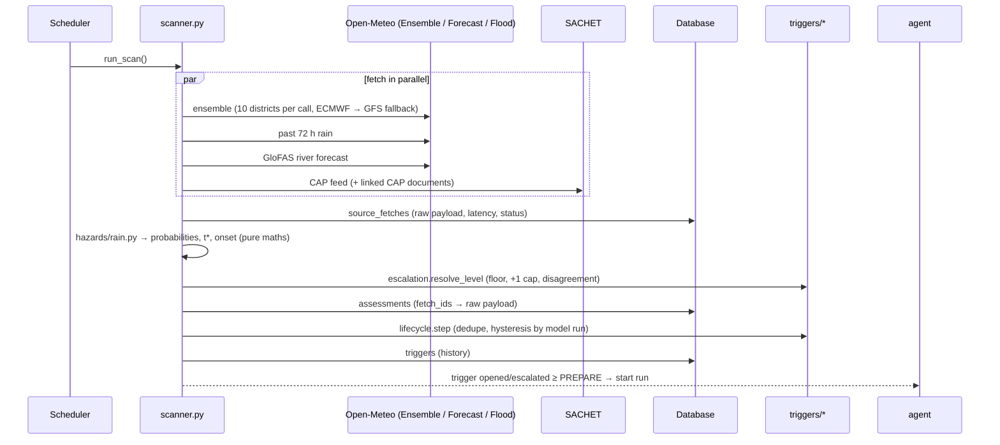
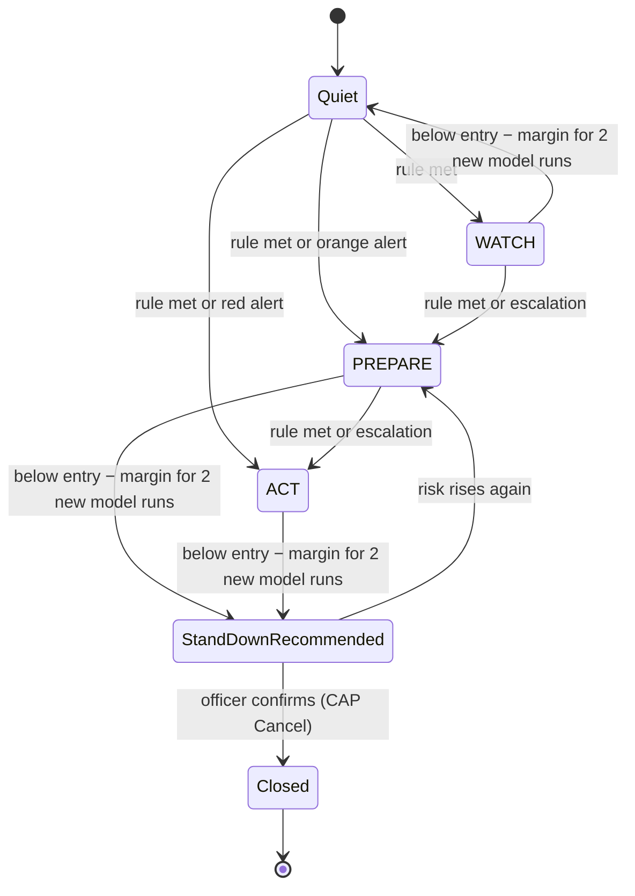
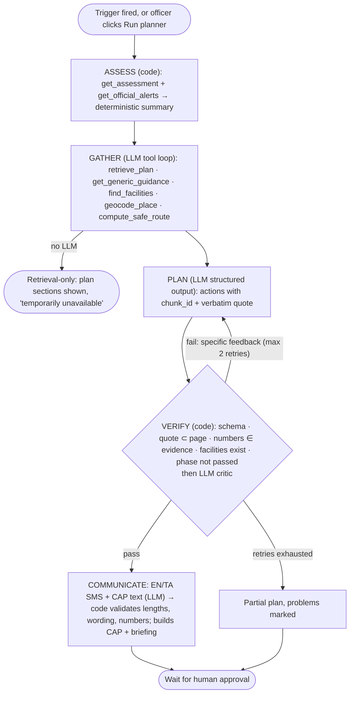
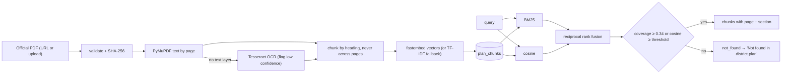

# Architecture walkthrough

A guide any team member can use to walk a judge through T-Minus (golden rule 5).

## 1. One scan, end to end

Files: `app/scanner.py`, `app/sources/*`, `app/hazards/*`, `app/triggers/*`.

## 2. The 51-futures maths (`app/hazards/ensemble_math.py`)

* `rolling_accumulation(members, 24)` — prefix sums per member; a 24-h total is NaN if any hour is missing (missing is never zero).
* `exceedance(acc, times, X, now, W)` — share of *valid* members whose max 24-h total in `[now, now+W]` reaches X. Returns counts, so the UI can say "38 of 51".
* `lead_time(...)` — `t*` = hour where the share of members ≥ X is highest (earliest on ties); onset = first hour with ≥ 10% of members ≥ X; T-minus = t* − now.

## 3. Level resolution and lifecycle (`app/triggers/`)

* `levels.evaluate_rain_rules(p, cfg, margin)` — base level; with `margin=0.15` it gives the *hysteresis level*.
* `escalation.resolve_level(...)` — floor → +1 escalation (saturated ground / compound) → cap → disagreement flag.
* `lifecycle.step(existing, observation)` — pure decision (open / upgrade / count_below / downgrade / stand_down / reactivate); `scanner.apply_lifecycle` persists it.

## 4. The agent (`app/agent/`)

* `tools.py` — the registry: strict JSON schemas, budget (20 calls), each call and result emitted to the trace; tool output wrapped as `<tool_output trust="untrusted-data">` (prompt-injection hygiene).
* `verify.py` — the hard checks; returns messages like `A4: quote not found on p. 117`.
* `graph.py` — the LangGraph `StateGraph`; `runner.py` — run lifecycle, SSE events, persistence, citation enrichment.
* `llm.py` — `LLMClient` interface; `AnthropicLLM` (adaptive thinking with summarised reasoning streamed to the trace, structured outputs, server-side refusal fallback) and `FailoverLLM` (primary → backup model).

## 5. Retrieval (`app/rag/`)

## 6. Approval and publishing (`app/api/runs.py`)

1. Officer edits messages (`PATCH /api/communications/{id}`) — re-validated (GSM-7 ≤ 160, Tamil ≤ 134).
2. `POST …/confirmation` returns exactly what will be published plus a 5-minute token = HMAC(comm id, SHA-256 of the EN+TA text, expiry).
3. `POST …/approve` with the token: re-validates, rebuilds the CAP from the approved text, validates it against the OASIS XSD (status must be `Exercise`), creates the public alert, writes approvals to the append-only audit log. If the text changed after confirmation, the token no longer matches.

## 7. Traceability chain (why every number is real)

`UI number → /api/districts/{id} → assessments.probabilities → assessments.fetch_ids → source_fetches.raw_payload (+ SHA-256, URL, params, timestamp)`; `/api/assessments/{id}/recompute` re-derives every probability from that payload.
